# Traffic Replay Gate

[](https://github.com/sonujha78/traffic-replay-gate/actions/workflows/ci.yml)
[](https://github.com/sonujha78/traffic-replay-gate/actions/workflows/gate.yml)


A release gate that **records real HTTP traffic, replays it against a new version of a service in CI, and blocks the pull request when the answers or the speed change in a way nobody intended.**

<p align="center">
  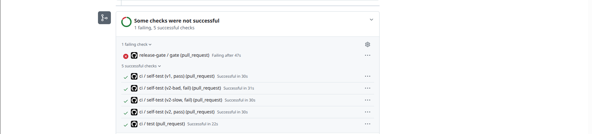
</p>

The screenshot above is a real pull request that ships a breaking change. The `release-gate / gate` check is red. The four `self-test` jobs are green because they prove the gate itself behaves: good versions pass and bad versions fail.

## Table of contents

- [The problem](#the-problem)
- [How it works](#how-it-works)
- [What the gate catches](#what-the-gate-catches)
- [How it was built, step by step](#how-it-was-built-step-by-step)
- [Results](#results)
- [Problems met and how they were fixed](#problems-met-and-how-they-were-fixed)
- [The rules file](#the-rules-file)
- [Command line](#command-line)
- [Quick start](#quick-start)
- [Tests and CI](#tests-and-ci)
- [Project structure](#project-structure)
- [Limitations and next steps](#limitations-and-next-steps)
- [Interview talking points](#interview-talking-points)
- [Clean up](#clean-up)

## The problem

Unit tests check the cases a developer thought of. Real users send requests nobody thought of. A new version can pass every test, ship, and then break behaviour for real traffic: a field disappears from a response, a number turns into a string, an error code changes, a query gets ten times slower.

Most pipelines cannot answer the question that matters before a release:

> Does the new version answer real requests the same way the old version did?

This project answers it with evidence, automatically, on every pull request.

## How it works

1. **Record once** from a known-good version. A small reverse proxy sits in front of the service, forwards every request untouched and saves a masked copy of the request and response. The service code does not change.
2. **Replay on every pull request.** The gate sends the saved requests to the candidate version and compares each answer with the recorded one: status code, chosen headers, the JSON body field by field, and the latency per endpoint.
3. **Decide with rules.** A YAML file says which differences are noise, which are warnings and which block the release.
4. **Report.** A Markdown report appears as a pull request comment, on the job summary and as a downloadable artifact. The exit code (0 pass, 1 fail) turns the check green or red.

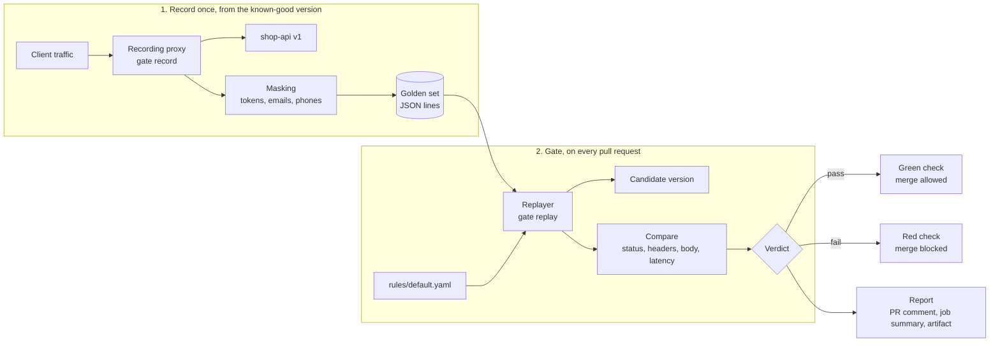

### How one difference becomes a verdict

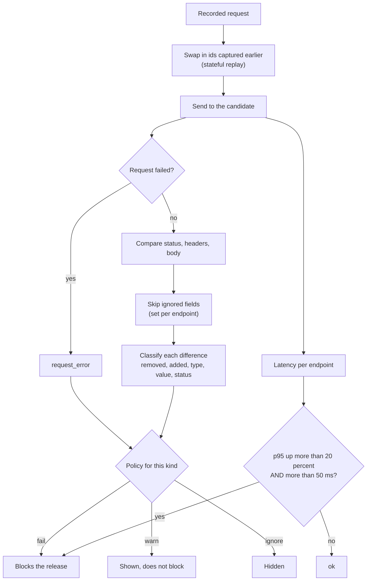

### How a stateful flow is replayed

An order created during recording has an id that will never exist in the candidate. The replayer learns the new id from the create call and uses it for the requests that follow.

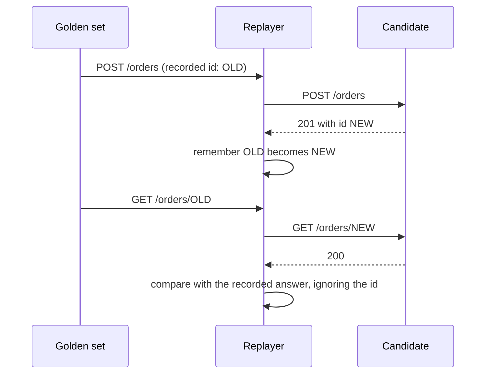

## What the gate catches

The demo service `shop-api` has four versions controlled by `APP_VERSION`. Each one proves a different behaviour of the gate.

| Version | What changed | Verdict | Why |
|---|---|---|---|
| `v1` | Baseline, the version that was recorded | Pass | Nothing changed. Noise such as order ids and timestamps is ignored. |
| `v2` | Adds a `currency` field to products | Pass | An added field is only a warning, so additive changes do not block. |
| `v2-bad` | Drops `stock`, turns `price` into a string, answers 200 instead of 404 for an unknown product | Fail | Removed field, type change and status change all block. |
| `v2-slow` | Same answers as `v2`, but the product list is 250 ms slower | Fail | The latency rule catches a regression that no functional test would see. |

## How it was built, step by step

Every step was built, tested and pushed before moving on, so the commit history tells the same story.

### Step 1: GitHub repository

- **What:** A public repository with a description, MIT license and topics (devops, ci-cd, golang, github-actions, regression-testing, traffic-replay, release-engineering, api-testing, docker, quality-gates).
- **Why:** Recruiters look at GitHub first. A clear name, description and topics make the project easy to find and understand in seconds.
- **Result:** Repository created and cloned. Every later change was committed in small, meaningful steps.

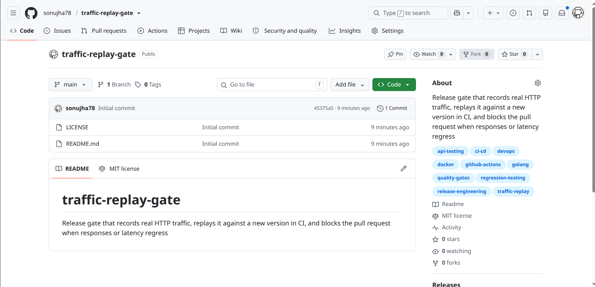

### Step 2: A demo service with good and bad versions

- **What:** `shop-api`, a small FastAPI service with products, orders and a user endpoint, run with Docker Compose. One environment variable, `APP_VERSION`, switches it between `v1`, `v2`, `v2-bad` and `v2-slow`. Order responses contain random ids and timestamps, and `/users/me` contains an email and a phone number.
- **Why:** A gate is only believable if it is shown catching a real bad change. The service was designed so that every hard part of the problem exists on purpose: noise to ignore, secrets to mask, state to replay and a version that must be rejected.
- **Result:** Verified with curl. `v1` returns `stock` and answers 404 for an unknown product. `v2-bad` drops `stock`, returns the price as the string `"299.0"` and answers 200 for an unknown product.
- **Commit:** `feat(demo): add shop-api demo service with good and bad versions`

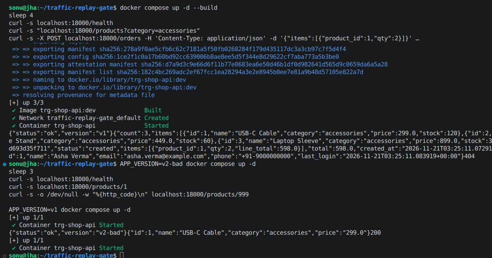

### Step 3: The recorder (a reverse proxy)

- **What:** `gate record` starts a Go reverse proxy in front of the service. It forwards every request untouched and writes a masked copy to a JSON-lines file. Health checks are forwarded but not recorded, and a failed upstream call is never recorded.
- **Why:** Recording at the network edge means the service needs no code change, no agent and no library. Anything that speaks HTTP can be recorded.
- **Result:** 17 requests recorded from a realistic mix: product lists, single products, a 404, an order created and then read back, a 400, a 422 and an authenticated call.
- **Commit:** `feat(recorder): add recording proxy with masking and a v1 golden set`

### Step 4: Masking, so secrets never reach disk

- **What:** Masking happens before a record is written. Sensitive headers (`Authorization`, cookies, API keys) and sensitive JSON fields at any depth (`password`, `token`, `email`, `phone`, and more) are replaced with `***MASKED***`. Extra field names can be added with a flag. Numbers keep their exact text, so `299.0` is not rewritten.
- **Why:** A golden set is committed to Git and read by many people. If a secret can reach the file, the tool is unsafe to use on real traffic.
- **Result:** Searching the golden file for the bearer token, the email address and the phone number finds nothing. The authenticated response shows `***MASKED***` where the email and phone were.

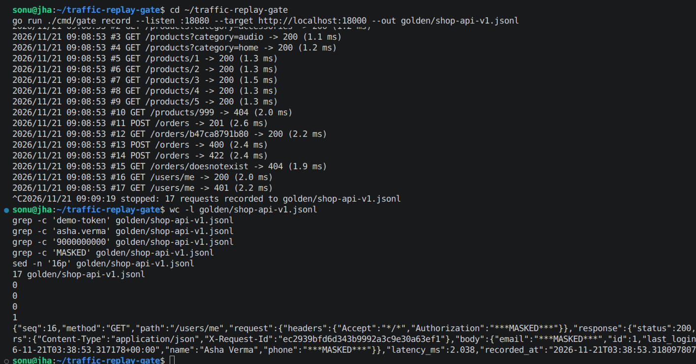

### Step 5: The rules file

- **What:** `rules/default.yaml` says what counts as a regression. Each kind of difference has a severity: `fail` blocks the release, `warn` is shown only, `ignore` is hidden. Noise is ignored per endpoint, for example `id` and `created_at` on `POST /orders`. The file is validated on load, and a typo in a key or severity is an error instead of being silently ignored.
- **Why:** Teams need to tune the gate without touching code, and a noisy gate gets switched off. Making ignore rules per endpoint, never global, means a real bug in `items[].id` is not hidden just because `id` is noise at the top level.
- **Result:** The same file expresses the whole policy: removed fields, type changes and status changes fail, added fields only warn, and the latency limits are set in one place.

### Step 6: The comparison engine

- **What:** A JSON comparison in Go that walks both documents and reports each difference with its kind and exact path, such as `$.items[3].price`. It understands removed and added fields, type changes, value changes, numbers compared by value (`299.0` equals `299`), arrays whose order does not matter, and ignored fields. Latency is compared as the p95 per endpoint, and a regression needs both a percentage limit and an absolute limit to be exceeded.
- **Why:** A plain text diff is useless for JSON because key order and formatting differ. Reporting the exact path and the kind of change is what makes a failure actionable. The two latency limits stop a jump from 1 ms to 2 ms on a fast endpoint from failing the build, while 1 ms to 250 ms still does.
- **Result:** Unit tests cover every kind of difference, scoped ignore rules, unordered arrays and both sides of the latency rule.

### Step 7: The replayer, including stateful flows

- **What:** `gate replay` sends every recorded request to the candidate in order, compares each answer and computes a verdict. Rules can name `capture_fields` for an endpoint (for example the `id` returned by `POST /orders`). The replayer remembers the new value and substitutes it into later requests, so "create an order, then read it" works. Headers that were masked at record time are filled from `--header Name=Value`, and only for requests that originally carried that header, so a call that was recorded without credentials still gets a 401.
- **Why:** Real traffic is not a list of independent calls. Without id remapping, every read after a create would fail for the wrong reason. Filling credentials only where they existed keeps the replay faithful to what was recorded.
- **Result:** The exit code is 0 for pass, 1 for fail and 2 for a usage or runtime error, so any CI system can use it. Running the same replay twice gives the same verdict, which is covered by a test.
- **Commit:** `feat(replay): add replayer with stateful id remapping, verdict, reports and gate replay command`

### Step 8: Reports a human can read

- **What:** Each run writes `report.md` and `report.json`. The first version listed one row per field per list item, so one bug showed up 44 times. Repeated differences on array items are now grouped (`$.items[].price`, Count 8), and the header counts distinct issues.
- **Why:** A report nobody reads does not stop a bad release. 44 findings looks like chaos, 6 distinct issues looks like a short to-do list. The raw detail stays in `report.json`.
- **Result:** The bad version produces 44 findings that collapse into 6 distinct issues, shown in a table per request.
- **Commit:** `feat(report): group repeated findings, raise latency floor to 50 ms`

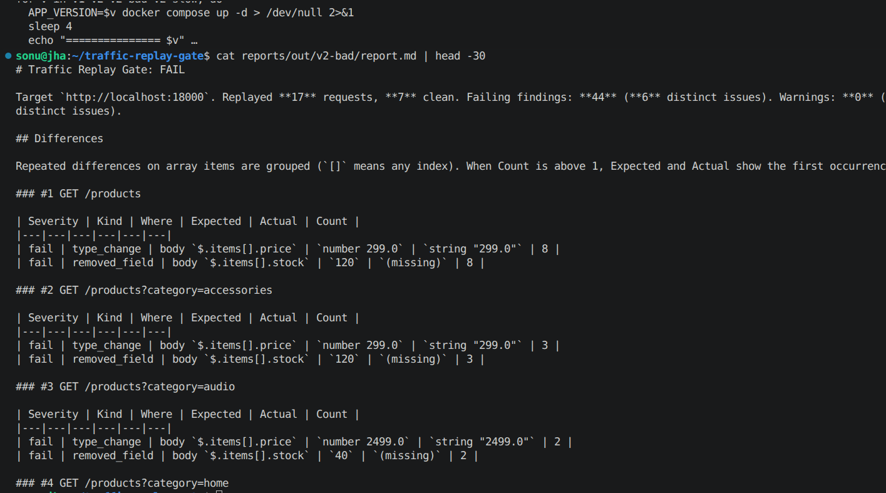

### Step 9: GitHub Actions

- **What:** Two workflows. `release-gate` starts the candidate with Docker Compose, replays the golden set, comments the report on the pull request (updating the same comment on every push), writes the job summary and uploads the report. `ci` runs gofmt, vet and unit tests, then a **self-test**: a matrix that runs the gate against all four versions and checks that `v1` and `v2` pass while `v2-bad` and `v2-slow` fail.
- **Why:** The self-test proves the gate itself. A gate that always passes is worse than no gate, so there is a standing check that bad versions are still rejected.
- **Result:** Both workflows pass on `main`. The release gate takes about 45 seconds and the whole `ci` workflow about 1 minute 16 seconds.
- **Commit:** `ci: add release gate workflow and gate self-test`

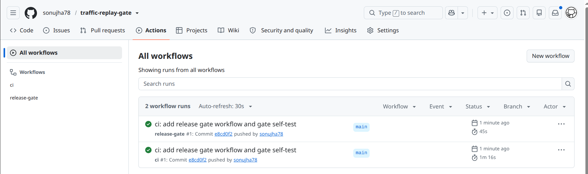

### Step 10: Prove it blocks a bad release

- **What:** A branch `demo/bad-release` changes the candidate version to `v2-bad` and opens a pull request. The gate fails, and the report is posted on the pull request. A branch ruleset on `main` then makes the `gate` check required.
- **Why:** The whole point is stopping a bad merge. Showing it on a real pull request is stronger than saying it.
- **Result:** The pull request shows 17 requests replayed, 7 clean, 44 findings in 6 distinct issues, and the `release-gate / gate` check failing while the 4 self-tests and the unit-test job pass.

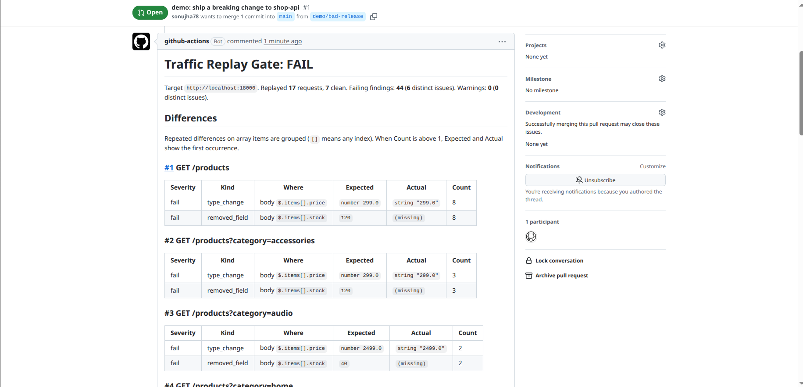

The rest of the report, including a status change for an unknown product and the latency table:

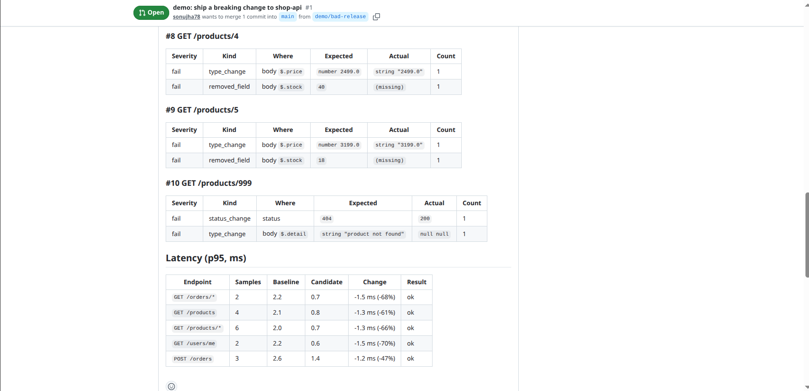

The branch ruleset requires the `gate` check before anything reaches `main`:

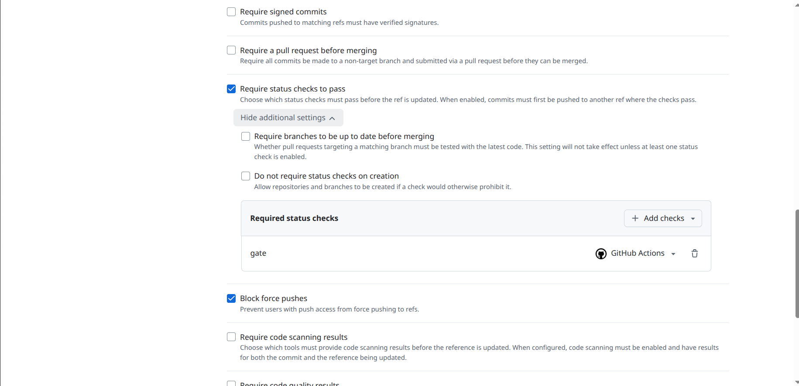

## Results

| Check | Outcome |
|---|---|
| Traffic recorded from the demo service | 17 requests in a JSON-lines golden set |
| Secrets in the golden file | None. Token, email and phone are masked before writing. |
| Replay against `v1`, `v2` | Pass |
| Replay against `v2-bad` | Fail: 17 requests, 7 clean, 44 findings in 6 distinct issues |
| Replay against `v2-slow` | Fail from the latency rule |
| Same replay run twice | Same verdict (covered by a test) |
| Stateful flow (create an order, then read it) | Works through id remapping |
| Gate self-test in CI | 4 versions, each checked for the expected verdict |
| Pull request with the bad version | `release-gate / gate` red, report commented on the pull request |
| Unit tests | Packages mask, recorder, rules, compare, replay and report all pass |

## Problems met and how they were fixed

| Problem | Cause | Fix |
|---|---|---|
| One bug showed up 44 times in the report | A list of 8 products reported the same problem on every item | Group findings by kind and collapsed path (`$.items[].price`), and count distinct issues |
| Replaying `GET /users/me` would always fail | The token was masked in the golden set, so the replay sent no credentials | Fill masked headers from `--header`, only on requests that originally had them |
| Reading an order after creating it returned 404 | Order ids are random, so the recorded id does not exist in the new run | `capture_fields` on the create endpoint, then substitute the new id into later requests |
| Ignoring `id` could hide a real bug | A global ignore also hides `items[].id` | Ignore rules are per endpoint, never global |
| Tiny latency changes could fail the build | 1 ms to 2 ms is a 100 percent increase on a fast endpoint | A regression needs both the percentage limit and an absolute limit, and the absolute limit was raised to 50 ms for shared CI runners |
| `299.0` versus `299` looked like a change | JSON numbers were parsed as floats and printed differently | Numbers are kept as their original text and compared by value, so only a real type change is reported |
| A typo in the rules file could silently disable a rule | YAML ignores unknown keys by default | The rules loader rejects unknown keys, kinds and severities |

## The rules file

```yaml
# fail = blocks the pull request, warn = shown in the report only, ignore = hidden
policy:
  status_change: fail
  removed_field: fail
  type_change: fail
  value_change: fail
  added_field: warn
  header_change: warn
  request_error: fail

compare_headers: [Content-Type]

# A latency regression needs BOTH limits exceeded.
latency:
  max_p95_increase_pct: 20
  min_increase_ms: 50
  severity: fail

# Noise is ignored per endpoint, never globally.
endpoints:
  - match: "POST /orders"
    ignore_fields: [id, created_at]
    capture_fields: [id]          # later requests use the new id
  - match: "GET /orders/*"
    ignore_fields: [id, created_at]
  - match: "GET /users/me"
    ignore_fields: [last_login]
```

| Setting | Meaning |
|---|---|
| `ignore_fields` | Field paths that are noise, such as `id` or `items[].id` |
| `unordered_arrays` | Arrays whose element order does not matter |
| `capture_fields` | Response fields remembered and substituted into later requests |
| `compare_headers` | The only response headers that are compared |
| `latency` | p95 limits per endpoint, both a percentage and an absolute one |

## Command line

```
gate record --target http://localhost:18000 --listen :18080 --out golden/shop-api-v1.jsonl
gate replay --target http://localhost:18000 --golden golden/shop-api-v1.jsonl \
            --header "Authorization=Bearer demo-token-123"
```

| Flag | Command | Meaning |
|---|---|---|
| `--target` | both | Base URL of the service to record, or of the candidate to replay against |
| `--listen` | record | Address of the recording proxy (default `:18080`) |
| `--out` | record | Golden set file to write |
| `--skip` | record | Path prefixes forwarded but not recorded (default `/health`) |
| `--mask-fields` | both | Extra JSON field names to mask |
| `--golden` | replay | Golden set to replay |
| `--rules` | replay | Rules file (default `rules/default.yaml`) |
| `--header` | replay | Real value for a header that was masked at record time, `Name=Value`, repeatable |
| `--out-dir` | replay | Where `report.md` and `report.json` are written |
| `--warmup-path` | replay | Path requested a few times first so a cold start is not counted |

Exit codes: `0` pass, `1` fail, `2` usage or runtime error.

## Quick start

You need Docker with Compose and Go 1.22.

```bash
# 1. Start the baseline version of the demo service
docker compose up -d --build

# 2. Record traffic through the proxy (leave this running)
go run ./cmd/gate record --listen :18080 --target http://localhost:18000 \
  --out golden/shop-api-v1.jsonl

# 3. In another terminal, send some traffic, then stop the recorder with Ctrl+C
bash scripts/gen-traffic.sh

# 4. Replay the golden set against each version
for v in v1 v2 v2-bad v2-slow; do
  APP_VERSION=$v docker compose up -d
  sleep 4
  go run ./cmd/gate replay --target http://localhost:18000 \
    --golden golden/shop-api-v1.jsonl \
    --header "Authorization=Bearer demo-token-123" --out-dir reports/out/$v
done
```

A recorded golden set is already in `golden/shop-api-v1.jsonl`, so steps 2 and 3 can be skipped.

## Tests and CI

```bash
go test ./... -race -count=1
```

- Unit tests cover masking, the recorder (including that secrets never reach the file), the rules loader, every kind of difference, the latency rule, the replayer (including stateful ids, credentials and repeatability) and the report.
- `ci` runs gofmt, vet, unit tests and the four-version self-test.
- `release-gate` runs the real gate on every pull request and on `main`.

## Project structure

```
cmd/gate/            Command line: record and replay
internal/golden/     Golden set format, written and read as JSON lines
internal/mask/       Masking of headers, query strings and JSON fields
internal/recorder/   Recording reverse proxy
internal/rules/      Rules file loader and endpoint matching
internal/compare/    Status, header and JSON body comparison, p95 latency
internal/replay/     Replayer, stateful id remapping, verdict
internal/report/     Markdown, JSON and terminal reports
demo/shop-api/       Demo FastAPI service with four versions
golden/              The recorded golden set
rules/               The rules file
scripts/             Traffic generator
.github/workflows/   release-gate and ci
```

## Limitations and next steps

- HTTP and JSON only. gRPC and WebSocket traffic are not supported.
- The baseline latency in the golden set was measured through the recording proxy, so absolute numbers are only roughly comparable. A better design replays the same golden set against the previous version in the same CI run and compares the two.
- Stateful replay handles ids returned by a create call. More complex flows, such as tokens that expire or multi-step workflows, need more rules.
- In this demo the candidate version comes from a file in the repository. In a real project the candidate would be built from the pull request's own code.
- The golden set is recorded by hand. A next step is sampling live traffic and keeping only requests that add coverage.
- Replay sends writes to the candidate, so it must run against an isolated test instance, never production.

## Interview talking points

- **Why record real traffic instead of writing more tests?** Real users send requests nobody imagined. A golden set from real traffic covers inputs a developer would never write, and it needs no change to the service.
- **How do you avoid false alarms?** Noise is ignored per endpoint (ids, timestamps), numbers are compared by value, unordered arrays can be sorted, and only chosen headers are compared. Ignoring globally would hide real bugs, so it is never global.
- **How do you handle state?** The replayer learns values from responses (`capture_fields`) and substitutes them into later requests, so create-then-read works.
- **How do you handle secrets?** Masking happens before anything is written, covering headers and JSON fields at any depth. Credentials for replay come from flags or CI secrets, and only go on requests that originally had them.
- **Why is the severity configurable?** Different teams accept different risk. An added field is usually safe, a removed field is not. The policy lives in YAML so it can be tuned in review without code changes.
- **How do you catch performance regressions without flaky builds?** Compare p95 per endpoint and require both a percentage and an absolute increase. Add a warm-up so a cold start is not counted.
- **How do you know the gate itself works?** A self-test matrix runs it against known good and known bad versions in CI and checks each verdict. If the gate ever stops catching the bad version, CI goes red.
- **How does it block a merge?** The job exits non-zero on a fail verdict, and a branch ruleset requires that check on `main`.
- **What would you do next?** Replay against the previous version in the same run for an A/B latency comparison, sample live traffic to grow the golden set, and support gRPC.

## Clean up

```bash
docker compose down
docker rmi trg-shop-api:dev
```

## License

MIT
